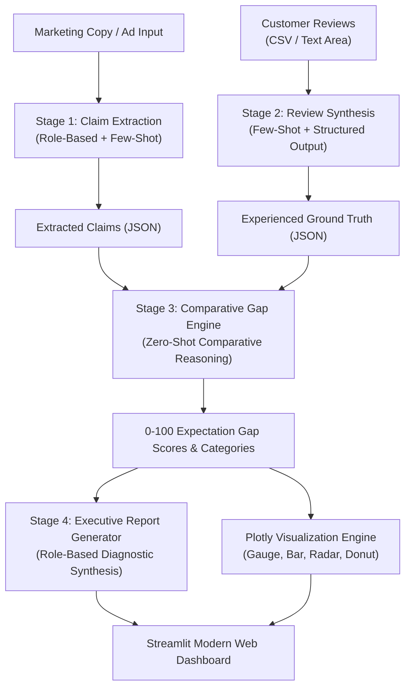

# TRUTHGAP: Academic Project & Viva Defense Guide

**Project Title:** TRUTHGAP – A Prompt-Engineered AI System for Detecting Expectation Gaps Between Product Claims and Consumer Experience  
**Level:** Third-Year Engineering Academic Project  
**Technology Stack:** Python 3.10+, Google Gemini API (`google-genai`), Streamlit, Pandas, Plotly  

---

## 1. Executive Summary & Problem Statement

### The Problem
Modern consumer product marketing is saturated with aggressive, exaggerated, and sometimes outright fraudulent claims (e.g., *"48-hour battery"*, *"indestructible military-grade glass"*, *"blocks 99% of noise"*). Conversely, genuine consumer feedback is scattered across thousands of e-commerce reviews. Manually cross-referencing advertised specifications against authentic customer experiences is time-consuming and subjective.

### The Solution: TRUTHGAP
TRUTHGAP is an algorithmic product integrity auditing platform. By applying **advanced prompt engineering** to Large Language Models (LLMs), TRUTHGAP extracts factual claims from marketing copy, synthesizes ground-truth customer experiences, and quantitatively measures the **Expectation Gap Score (0 to 100)** across individual features with diagnostic explanations and interactive visualizations.

---

## 2. System Architecture

---

## 3. The 4 Core Prompt Engineering Techniques Explained

When your project examiners ask you to explain your prompt engineering implementation, refer to these four pillars:

### 1. Role-Based Prompting (Persona Anchoring)
* **Where Used:** `CLAIM_EXTRACTION_SYSTEM_PROMPT` and `EXECUTIVE_REPORT_SYSTEM_PROMPT`.
* **Persona:** *"Senior Consumer Protection and Advertising Standards Auditor"*.
* **Why It Matters:** Without persona conditioning, LLMs tend to be agreeable and summarize marketing fluff as truth. Anchoring the model in an auditing persona enforces skepticism, stripping away promotional buzzwords (e.g., *"revolutionary"*, *"best-in-class"*) and isolating only verifiable, testable metrics.

### 2. Few-Shot Demonstration Prompting
* **Where Used:** `CLAIM_EXTRACTION_USER_TEMPLATE` and `REVIEW_SYNTHESIS_USER_TEMPLATE`.
* **Mechanism:** Providing 1–2 complete input-output pairs inside the prompt before the target text.
* **Why It Matters:** Few-shot examples teach the model how to standardize feature nomenclature (e.g., translating *"it didn't survive a quick shower"* into `"Water Resistance": "Customer experienced liquid failure"`). This prevents feature mismatch when comparing claims with reviews.

### 3. Structured-Output Prompting (Deterministic Schema Enforcement)
* **Where Used:** Across all intermediate extraction and comparison stages.
* **Mechanism:** Using `response_mime_type="application/json"` with an explicit JSON schema specifying types, keys, and values.
* **Why It Matters:** Eliminates unconstrained natural language chatter and guarantees that outputs can be converted directly into Python dictionaries, Pandas DataFrames, and Plotly charts without parsing crashes.

### 4. Zero-Shot Comparative Reasoning
* **Where Used:** `GAP_COMPARISON_SYSTEM_PROMPT`.
* **Mechanism:** Presenting the structured claims and structured customer feedback side-by-side without pre-computed answers, instructing Gemini to evaluate disparity.
* **Why It Matters:** Demonstrates the LLM's intrinsic ability to reason over quantitative benchmarks (e.g., 48 hours promised vs. 14 hours observed) and assign an objective 0–100 score.

---

## 4. Expectation Gap Scoring Formula & Taxonomy

TRUTHGAP classifies the disparity between marketing promises and actual performance into a 3-tier taxonomy:

$$\text{Expectation Gap Score} \in [0, 100]$$

| Range | Gap Category | Verdict | Description |
| :---: | :---: | :---: | :--- |
| **0 – 30** | **Low Gap** | **Verified** | Product largely fulfills or exceeds the advertised claim. Consumer sentiment is positive. |
| **31 – 60** | **Moderate Gap** | **Exaggerated** | Partial fulfillment with noticeable caveats, conditional performance, or minor compromises. |
| **61 – 100** | **High Gap** | **Misleading** | Severe divergence. The product fails to deliver on advertised benchmarks in typical real-world use. |

$$\text{Overall Gap Score} = \frac{1}{N} \sum_{i=1}^{N} \text{GapScore}_i$$

*(Where $N$ is the number of verifiable product features evaluated).*

---

## 5. Top 10 Viva Questions & Winning Answers

### Q1: Why did you use Prompt Engineering instead of training a Machine Learning model from scratch?
> **Answer:** Training a traditional NLP model (like BERT or an LSTM) from scratch requires thousands of labeled, paired training examples of claims and customer reviews, which are scarce and expensive to annotate. Furthermore, traditional classifiers only predict sentiment polarity (positive/negative); they cannot reason over numerical discrepancies (e.g., comparing 48h claimed vs. 14h actual). Modern LLMs like Gemini 2.5 Flash, when conditioned with structured prompt engineering, perform zero-shot and few-shot reasoning at a fraction of the cost, development time, and computational overhead.

### Q2: What is the purpose of setting `temperature = 0.2`?
> **Answer:** In generative AI, temperature controls the probability distribution of generated tokens. A high temperature (0.7–1.0) increases randomness and creativity, which is suitable for creative writing but dangerous for an audit system. Setting `temperature = 0.2` forces the model toward greedy, deterministic decoding, ensuring consistent, repeatable, and objective evaluation scores.

### Q3: How do you prevent the AI from hallucinating claims that were never made?
> **Answer:** We use three safeguards:
> 1. Role-based instructions strictly restricting the model to text provided between explicit delimiters (`--- PRODUCT ADVERTISEMENT ---`).
> 2. Few-shot examples illustrating the exact difference between subjective marketing fluff and testable claims.
> 3. Enforcing structured JSON output with a specific `claim_metric` field, requiring the AI to quote or cite exact metrics directly from the source text.

### Q4: How does your system handle sarcasm or mixed sentiment in customer reviews?
> **Answer:** Traditional rule-based sentiment tools (like VADER or TextBlob) struggle with sarcasm (e.g., *"Sure, 48 hours battery if you never turn it on!"*). LLMs possess deep contextual semantic understanding. In our Few-Shot Review Synthesis prompt, Gemini recognizes that sarcastic phrases express dissatisfaction and extracts the factual experience (battery dies quickly), correctly assigning negative sentiment and high discrepancy.

### Q5: What happens if a user enters a completely unrelated advertisement or garbage reviews?
> **Answer:** We implemented multi-tier error handling:
> 1. Frontend validation in `app.py` blocks empty inputs.
> 2. Backend validation in `src/analyzers.py` verifies data types and row counts.
> 3. If an ad contains no testable claims, the prompt returns an empty list, and the analyzer raises an informative `ValueError` which the Streamlit UI displays as a clear warning.

### Q6: Why did you separate the code into modular files (`config.py`, `prompts.py`, `analyzers.py`, etc.)?
> **Answer:** To follow standard software engineering principles: Separation of Concerns (SoC) and DRY (Don't Repeat Yourself). The visual UI (`app.py`) is decoupled from the business logic (`analyzers.py`), the prompt repository (`prompts.py`), and the configuration (`config.py`). This allows us to modify prompts or upgrade models without touching the dashboard code.

### Q7: How are API keys secured in this project?
> **Answer:** We follow the industry standard 12-Factor App methodology. The secret key is stored in an ignored `.env` file and loaded into memory using `python-dotenv`. The `.gitignore` file guarantees that `.env` cannot be accidentally pushed to Git repositories, preventing secret exposure.

### Q8: What are the primary limitations of the current implementation?
> **Answer:** 
> 1. Dependency on external API availability and internet connectivity.
> 2. Context window and rate limits when processing tens of thousands of reviews at once (which can be scaled using batch processing or chunked map-reduce pipelines).
> 3. Susceptibility to fake or bot-generated customer reviews if the dataset is not pre-filtered.

### Q9: What is the future scope of TRUTHGAP?
> **Answer:**
> 1. Automated fake review detection using bot-classifier heuristics before gap analysis.
> 2. Direct browser extension integration to audit Amazon, Flipkart, or BestBuy product pages in real time.
> 3. Multi-modal auditing: analyzing product unboxing videos and images alongside text reviews.

### Q10: Why did you choose Streamlit and Plotly?
> **Answer:** Streamlit allows rapid deployment of Python data science applications without complex HTML/CSS/JS frontend overhead. Plotly generates GPU-accelerated, interactive SVG/WebGL charts (with zoom, pan, hover tooltips) that allow examiners to interactively explore each feature's discrepancy directly.
